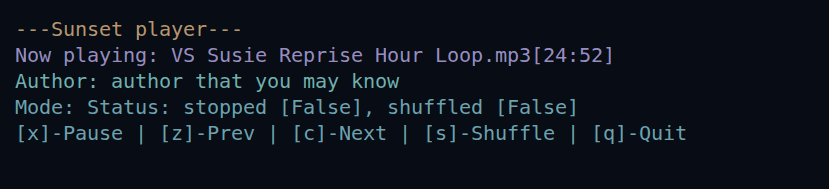
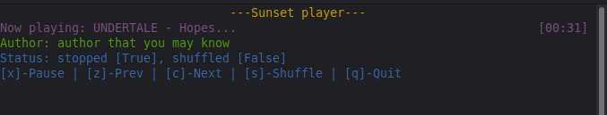

# Sunset player

## Important note
> This project is still under development. If you encounter any errors or bugs, please open an issue on this repository.
## V2 UPDATE

Refactoring code, and added:
- Playing time
- UI settings(Classic, Modern, Minimal)
- Now you can hide folder
## Description
This is a TUI Sunset player by **sunset_1225** or **Sunset-man**.


Built-in libraries:
- **sys**(for exit)
- **time**
- **pathlib**(for finding path and using it)
- **curses**(For checking key presses & for terminal rendering)
- **time**(To use sleep method)
- **platform**(For checking user's OS(maybe important soon!))

Dependencies libraries:
- **just_playback**(for audio) by cheofusi
- **tinytag**(for audio tags) by tinytag

## Control playback:
1. **Play/Pause** - Play and Pause your favourite tracks by using `x` key!
2. **Next/Previous** - Change your track if you want by using `z` for previous track and `c` for next track
3. **Shuffle** - if your playlist seems boring, shuffle it by using `s` key!
4. **Exit** - if you want to leave, press `q` key!

## Installation
1. Download Python(Python 3.8+ (uses standard libraries: curses, pathlib))
2. Clone project
```bash
git clone https://github.com/sunset-man/Sunset-Player
```
3. Navigate to the project folder
```bash
cd Sunset-Player
```
4. Go to config folder
```bash
cd config
```
5. Open configuration.py and update the Folder variable with your music directory path.

*Make sure to keep the trailing slash / at the end of the path!*

6. Download requirements
```bash
pip install -r requirements.txt
```
7. Run main.py file
```bash
python main.py
```
8. Enjoy!

### Windows Support (Experimental)
The project is developed on Linux and MacOS natively. For Windows, you need to install `windows-curses`:
```bash
pip install windows-curses
```

## Images

